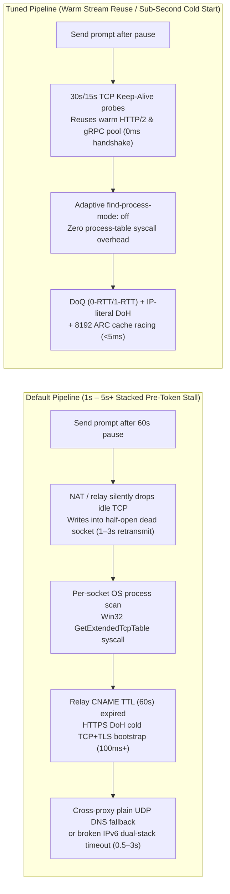

# Mihomo Low-TTFT Global Tuning Suite

**[English](./README.md) | [简体中文](./README_ZH.md)**

A cross-platform, subscription-agnostic **Mihomo (formerly Clash.Meta) global engine tuning suite** engineered to minimize **Time-To-First-Token (TTFT)** for streaming AI coding agents and LLM clients (**Google Antigravity**, **OpenAI Codex**, **Claude Code**, **Cursor**, **Windsurf**, etc.).

* **Supported Clients**: Clash Verge Rev (recommended), Mihomo Party, Sparkle, FlClash, and standalone Mihomo CLI (`v1.18+` / `v1.19+`)
* **Supported Platforms**: Windows 10/11, macOS, Linux
* **Core Philosophy**: **Zero Subscription Intrusion** — never alters your subscription's `rules` or `proxy-groups` hierarchy. Works seamlessly across unlimited subscriptions and survives automatic profile updates permanently.

---

## Table of Contents

1. [Why Do AI Coding Agents Suffer From Slow First Token but Fast Streaming?](#1-why-do-ai-coding-agents-suffer-from-slow-first-token-but-fast-streaming)
2. [Design Philosophy: Engine-Level Tuning vs. Rule Tampering](#2-design-philosophy-engine-level-tuning-vs-rule-tampering)
3. [Technical Deep-Dive: What Is Tuned and Why](#3-technical-deep-dive-what-is-tuned-and-why)
4. [Quick Start (Automated Installer / Manual Paste / Other Clients)](#4-quick-start-automated-installer--manual-paste--other-clients)
5. [GUI Settings Checklist: Coordinating DNS, TUN, and System Proxy](#5-gui-settings-checklist-coordinating-dns-tun-and-system-proxy)
6. [OS Network Stack & Wi-Fi Adapter Checklist (Eliminating Idle Wake Spikes)](#6-os-network-stack--wi-fi-adapter-checklist-eliminating-idle-wake-spikes)
7. [Benchmarking & One-Click Rollback](#7-benchmarking--one-click-rollback)

---

## 1. Why Do AI Coding Agents Suffer From Slow First Token but Fast Streaming?

Unlike web browsing, AI coding workflows are bursty: **you pause for 30–120 seconds reading code diffs or waiting for local test commands, then send the next turn**. Under default Mihomo settings, every new turn after an idle pause hits multiple stacked bottlenecks:



> **Note: Network TTFT vs. Model Reasoning Time**
> This suite eliminates **network-layer stalls** (DNS resolution, cold TCP/TLS handshakes, half-open socket retransmissions, and broken dual-stack timeouts — typically shaving `0.5s – 5s` off cold/idle turns). Server-side reasoning compute time (e.g., extended thinking tokens) occurs on remote GPUs and is independent of local proxy settings.

---

## 2. Design Philosophy: Engine-Level Tuning vs. Rule Tampering

Many guides hardcode custom rules like `DOMAIN-SUFFIX,googleapis.com,MyAirportGroup` into global merge templates. That approach breaks down in real-world usage:
1. **Breaks Across Multiple Subscriptions**: Switching to another provider with different group names (or `proxy-providers` / `RULE-SET` schemas) immediately causes Mihomo schema validation to fail.
2. **Disrupts Provider Routing**: Subscriptions maintain their own regional/AI routing policies and billing multipliers.

This suite strictly **decouples engine optimization from routing rules**:
* Applies tuning exclusively via **Global Merge (`Merge.yaml`) + Global Script (`Script.js`) + Global DNS Overwrite (`dns_config.yaml`)**;
* Leaves **100% of your subscription's `rules` and `proxy-groups` structure intact**, ensuring instant compatibility across all existing and future subscriptions.

---

## 3. Technical Deep-Dive: What Is Tuned and Why

### 3.1 Connection Pool Keep-Alive & Concurrent Dialing
* **`keep-alive-idle: 30` / `keep-alive-interval: 15` / `disable-keep-alive: false`**: Consumer routers (NAT) and transit relays frequently drop idle TCP mappings after 45–90 seconds without sending `RST`. Probing after 30s idle at 15s intervals keeps persistent HTTP/2 and gRPC streams to AI backends warm while you read code or run local tools.
* **`tcp-concurrent: true`**: Dials all resolved IPv4 addresses concurrently and immediately selects whichever completes the TCP handshake first.
* **`unified-delay: true`**: Measures full end-to-end HTTP round-trip latency rather than protocol-skewed handshake timings.
* **`bind-address: 127.0.0.1` (Adaptive)**: Binds local proxy ports strictly to loopback when `allow-lan` is `false`; automatically preserves wildcard binding when `allow-lan: true` so LAN device sharing continues working seamlessly.

### 3.2 Adaptive Process-Lookup Bypass
* **`find-process-mode: off` (Adaptive)**: On Windows, the default `strict` mode invokes Win32 `GetExtendedTcpTable` and `OpenProcess` across hundreds of system sockets on **every new TCP/UDP connection** before rule evaluation. `Script.js` inspects the active profile's rules: whenever no `PROCESS-NAME` / `PROCESS-PATH` rule is present, it automatically switches to `off`, eliminating kernel socket-table scans completely.

### 3.3 Multi-Carrier DNS Racing & High-Capacity ARC Cache
* **DNS-over-QUIC (`quic://223.5.5.5:853`) + IP-Literal DoH**:
  * Transit relay entry CNAMEs typically carry short 30–60s DNS TTLs. Hostname-based HTTPS DoH (`https://dns.alidns.com/dns-query`) requires a bootstrap lookup plus TCP + TLS handshakes whenever idle connections close.
  * Both `proxy-server-nameserver` and `nameserver` race **AliDNS DoQ (1-RTT handshake, 0-RTT resumption, zero TCP head-of-line blocking)** alongside **IP-literal DoH (`223.5.5.5`, `1.12.12.12`, `120.53.53.53`)** and plain UDP resolvers for `<5ms` resolution.
* **`fallback: []` + `respect-rules: false`**: Strips slow cross-proxy plain-UDP `1.1.1.1` / `8.8.8.8` fallbacks bundled by many subscriptions. Under `fake-ip`, proxied traffic forwards raw domain names directly to remote exit nodes for clean, local-zero-wait resolution.
* **`cache-algorithm: arc` + `cache-max-size: 8192`**: Uses Adaptive Replacement Cache with an 8,192-entry pool.
* **Self-Contained `fake-ip-filter` (Zero `geosite.dat` Dependency)**: Built-in wildcard exemptions cover LAN, mDNS, Docker, Tailscale, STUN, and OS captive-portal/connectivity probes across Windows (`msftncsi`), macOS (`captive.apple.com`), Linux, and mobile devices—preventing false "No Internet" OS flags without requiring external Geosite data files.

### 3.4 Anti-Jitter Health Checks & Fast Circuit Breaking
Without renaming or adding any groups, `Script.js` upgrades existing `url-test`, `fallback`, and `load-balance` groups:
* **`tolerance: 50`**: Mihomo defaults to `0ms` tolerance, switching nodes on 1–2ms ping noise—which resets active AI streams when `auto_close_connection` is enabled. A `50ms` threshold eliminates unnecessary flapping.
* **`timeout: 2500` + `max-failed-times: 2`**: Cuts dead-node detection latency in half compared to Mihomo's `5000ms` / 5-retry defaults.
* **Real TLS 1.3 Probing & Dummy Node Filtering**: Upgrades spoof-prone `http://` test URLs to `https://www.gstatic.com/generate_204`, and strips non-functional quota/expiry banner nodes (`Balance:`, `Expire:`, `剩余流量`, etc.) from automated candidate pools while keeping them visible in manual `select` menus.

### 3.5 Non-Intrusive Domain Sniffer & Standard Memory Loader
* **`sniffer` (`override-destination: false`)**: Extracts TLS SNI / HTTP Host on ports `80/443` solely for rule matching and Fake-IP recovery without overwriting destination IPs (preserving local `hosts` overrides and `curl --resolve` workflows). Skips RFC1918/CGNAT ranges via `skip-dst-address` and bypasses `ssh.github.com` to avoid Server-First SSH-over-443 delays.
* **`geodata-loader: standard` + `store-fake-ip: true`**: Replaces router-oriented `memconservative` mode with fast in-memory lookup tables and persists Fake-IP mappings across profile reloads.
* **Protocol-Aware `client-fingerprint: chrome`**: Injects Chrome uTLS fingerprints on TCP+TLS protocols (`vless / vmess / trojan / anytls / http`) while skipping QUIC-native `hysteria2 / tuic`.

### 3.6 Optional Feature Toggles (Top of `config/Script.js`)
Edit the `OPTIONS` block at the top of `config/Script.js` to customize behavior:

```javascript
var OPTIONS = {
  disableIPv6: true,          // Set false ONLY if both your ISP and proxy nodes have reliable native IPv6
  keepAliveIdle: 30,          // Idle seconds before sending TCP Keep-Alive probes
  keepAliveInterval: 15,      // Seconds between TCP Keep-Alive probes
  tuneAutoGroups: true,       // Tune interval/tolerance/circuit-breaker on existing url-test & fallback groups
  injectUtlsFingerprint: true,// Inject Chrome uTLS fingerprint on TCP+TLS proxies lacking one
  rejectOverseasQuic: false   // Optional: set true to prepend 1 group-independent rule rejecting non-CN UDP:443 (QUIC)
};
```

---

## 4. Quick Start (Automated Installer / Manual Paste / Other Clients)

### Option 1: One-Command Backup, Deploy & Kernel Verification (Clash Verge Rev)

The installer automatically locates your Clash Verge Rev directory, saves a timestamped backup, deploys the configs, and validates syntax via `verge-mihomo / mihomo -t`.

**Windows (PowerShell)**:
```powershell
git clone https://github.com/yaowu1st/mihomo-low-ttft.git
cd mihomo-low-ttft
powershell -ExecutionPolicy Bypass -File .\scripts\apply.ps1
```

**macOS / Linux (Bash)**:
```bash
git clone https://github.com/yaowu1st/mihomo-low-ttft.git
cd mihomo-low-ttft
chmod +x scripts/*.sh
./scripts/apply.sh
```

After running the script, open Clash Verge Rev → **Profiles** → right-click your active subscription and click **Use / Reload**.

---

### Option 2: Manual GUI Copy-Paste in Clash Verge Rev

1. **Global Merge (`Merge.yaml`)**: Go to **Profiles** → right-click **Merge (Global)** → **Edit File** → paste [`config/Merge.yaml`](./config/Merge.yaml) and save.
2. **Global Script (`Script.js`)**: Go to **Profiles** → right-click **Script (Global)** → **Edit File** → paste [`config/Script.js`](./config/Script.js) and save.
3. **Global DNS Overwrite (`dns_config.yaml`)**: Go to **Settings** → **DNS Overwrite** → edit and paste [`config/dns_config.yaml`](./config/dns_config.yaml), save, and toggle **DNS Overwrite** ON.

---

### Option 3: Mihomo Party / Sparkle / FlClash

* **Mihomo Party / Sparkle**: Navigate to **Override** → create a global YAML override with [`config/Merge.yaml`](./config/Merge.yaml) and a global JavaScript override with [`config/Script.js`](./config/Script.js), then enable both globally.
* **FlClash**: Navigate to **Tools → Override / Script** → add a global JavaScript script containing [`config/Script.js`](./config/Script.js) (`Script.js` is self-contained and applies all core, sniffer, and DNS settings on its own).

---

## 5. GUI Settings Checklist: Coordinating DNS, TUN, and System Proxy

Client GUI toggles (`tun`, `System Proxy`, `Log Level`, `DNS Overwrite`) are merged **last** on top of profiles. Configure these once in your client UI:

| Location | Setting | Recommended Value | Why It Matters |
| :--- | :--- | :--- | :--- |
| **Home / System** | **Proxy Mode** | **TUN Mode ON**<br/>*(System Proxy can remain ON simultaneously)* | **Dual-Active Synergy**: Keeping both System Proxy and TUN enabled lets Chromium/Electron apps (e.g., Antigravity) use `<1ms` local `127.0.0.1` HTTP loopback (automatically bypassing flaky UDP QUIC), while terminal CLIs (`codex`, `git`, MCP servers) are transparently routed via TUN. |
| **Settings → System Proxy** | **Proxy Bypass** | Append `198.18.*` (`;` delimiter on Windows, `,` on macOS) | Prevents processes that resolved a Fake-IP (`198.18.x.x`) via TUN from redundantly looping back into the local HTTP proxy port. |
| **Settings → TUN Mode** | **Stack** | **`Mixed`** | Uses the native OS kernel TCP stack for minimal handshake overhead and high throughput, paired with `gVisor` for reliable UDP NAT. |
| **Settings → TUN Mode** | **MTU** | **`9000`** | Virtual TUN adapters operate on in-memory ring buffers; jumbo `9000` frames cut kernel-to-userspace packet copy wakeups without affecting physical NIC wire MTU. |
| **Settings → TUN Mode** | **Strict Route** | **Enabled (`true`)** | Installs OS firewall rules (e.g., Windows WFP) to block broken IPv6 leaks on physical NICs and stop browser async DNS resolvers from bypassing TUN to query on-link router IPs (e.g., `192.168.1.1:53`). |
| **Settings → TUN Mode** | **DNS Hijack** | **`any:53,tcp://any:53`** | **No space after the comma!** Intercepts both standard UDP 53 and truncated-response TCP 53 fallbacks. |
| **Settings → TUN Mode** | **Route Exclude Address** | **Leave empty** *(do NOT add your router's subnet like `192.168.0.0/16`)* | Same-subnet LAN devices communicate directly at Layer 2 anyway; excluding `192.168.0.0/16` allows DNS packets targeting `192.168.1.1:53` to escape TUN hijacking. |
| **Settings → Clash** | **IPv6** | **Disabled (`false`)** | Eliminates `AAAA` lookup delays and broken dual-stack fallback stalls. |
| **Settings → Clash** | **Log Level** | **`warning`** | Eliminates per-connection string formatting and IPC log streaming overhead. |
| **Settings → DNS** | **DNS Overwrite** | **Enabled** | Enforces the optimized `dns_config.yaml` globally across all subscriptions. |

---

## 6. OS Network Stack & Wi-Fi Adapter Checklist (Eliminating Idle Wake Spikes)

Two OS/hardware-level issues frequently cause **300ms – 1500ms first-packet spikes after a few seconds of inactivity**, completely outside Mihomo:

### 6.1 Disable Broken Link-Local / Non-Routable IPv6 on Physical NICs
Many home, campus, and office routers advertise `fe80::1` via IPv6 Router Advertisements without upstream IPv6 internet connectivity, causing dual-stack lookups to hang until timeout.
* **Quick Check**: Run `curl -6 --noproxy "*" -I --connect-timeout 3 https://www.google.com` (or a domestic dual-stack site). If it times out or fails host resolution, your physical IPv6 path is non-functional.
* **Windows Fix**: Press `Win + R` → run `ncpa.cpl` → right-click your active adapter (`Wi-Fi` / `Ethernet`) → **Properties** → uncheck **`Internet Protocol Version 6 (TCP/IPv6)`** → OK.
* **macOS Fix**: `System Settings → Network → Wi-Fi → Details → TCP/IP → Configure IPv6 → Link-Local Only`.

### 6.2 Disable Laptop Wi-Fi Micro-Sleep Power Saving & Prefer 5GHz (Windows)
Laptop Wi-Fi chipsets (notably **MediaTek MT7921 / MT7922**, **Realtek**, and **Intel AX200/AX201/AX210/AX211**) aggressively enter low-power micro-sleep after just a few seconds of idle reading, adding a **`200ms – 800ms` radio wake-up spike** to the very first packet when you press Enter—compounded if the card roams onto congested 2.4GHz (`144 Mbps` link speed).
* **Windows Steps**: Right-click Start → **Device Manager** → **Network adapters** → double-click your Wi-Fi card → **Advanced** tab:
  * **Power Saving**:
    * MediaTek: Set **Power Saving** from `Auto` to **`Disabled`**;
    * Intel: Set **MIMO Power Save Mode** to **`No SMPS`**, and under the **Power Management** tab uncheck *"Allow the computer to turn off this device to save power"*.
  * **Band Preference**: Set **Preferred Band** to **`Prefer 5GHz band`** (or 5GHz/6GHz on Wi-Fi 6E/7 APs).

### 6.3 Proxy Node Selection Guidelines for AI Coding Agents
1. **Transport Protocol**: Prefer direct TCP/QUIC transports (**`VLESS + TCP (XTLS-Vision)` / `Trojan + TCP` / `Hysteria2` / `TUIC`**) over CDN-proxied **`WebSocket (ws)`** nodes, which add framing overhead and reverse-proxy buffering.
2. **Exit Region (Manual Pinning > Blind `url-test`)**: Because Hong Kong (`HK`) often has the lowest raw ICMP/HTTP ping from mainland China, `url-test` auto-groups frequently select HK nodes—triggering **OpenAI Codex / Claude regional blocks** or **Google Antigravity / Gemini secondary regional rerouting**. Manually pinning a clean **Japan (`JP`), Singapore (`SG`), Taiwan (`TW`), or US (`US`)** node delivers far more consistent TTFT.

---

## 7. Benchmarking & One-Click Rollback

### 7.1 Measure Stage-by-Stage Latency (`DNS / TCP / TLS / TTFT`)
After reloading your profile, run `curl` (replace `7897` with your `mixed-port`) to inspect exact timing breakdowns:

```bash
# Via local HTTP/SOCKS mixed-port
curl -x http://127.0.0.1:7897 -I -s -S -o /dev/null \
  -w "HTTP=%{http_code} | DNS=%{time_namelookup}s | TCP=%{time_connect}s | TLS=%{time_appconnect}s | TTFT=%{time_starttransfer}s\n" \
  https://www.google.com/generate_204

# Via pure TUN adapter (bypassing HTTP proxy)
curl --noproxy "*" -I -s -S -o /dev/null \
  -w "HTTP=%{http_code} | DNS=%{time_namelookup}s | TCP=%{time_connect}s | TLS=%{time_appconnect}s | TTFT=%{time_starttransfer}s\n" \
  https://www.google.com/generate_204
```

Expected healthy baseline: local proxy `TCP` connect `< 0.002s (2ms)`, pure TUN `DNS + TCP` `< 0.015s (15ms)`, cold-handshake `TTFT` around `0.25s – 0.55s` (depending on physical exit distance), and near-instantaneous response on warm connection reuse.

### 7.2 One-Click Rollback
Restore your pre-tuning snapshot anytime:

```powershell
# Windows (PowerShell)
powershell -ExecutionPolicy Bypass -File .\scripts\rollback.ps1
```

```bash
# macOS / Linux (Bash)
./scripts/rollback.sh
```

---

## License

[MIT License](./LICENSE)
