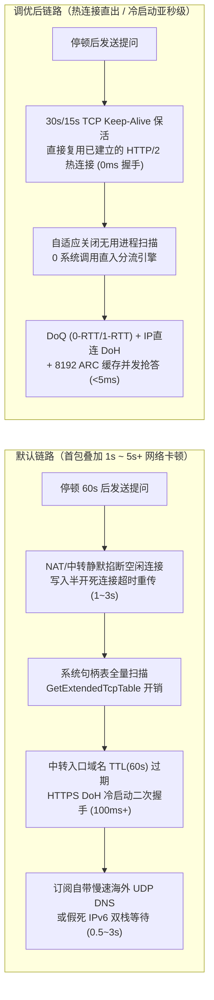

# Mihomo Low-TTFT Global Tuning Suite

**[English](./README.md) | [简体中文](./README_ZH.md)**

一套面向 **AI 编程工具与流式大模型客户端**（Google Antigravity、OpenAI Codex、Claude Code、Cursor、Windsurf 等）的 **Mihomo（原 Clash.Meta）跨平台、跨订阅全局低首字延迟（Low-TTFT）调优方案**。

* **适用客户端**：Clash Verge Rev（主推）、Mihomo Party、Sparkle、FlClash 及原生 Mihomo CLI（`v1.18+` / `v1.19+`）
* **适用系统**：Windows 10/11、macOS、Linux
* **核心特点**：**零订阅侵入**——不修改任何机场订阅的 `rules`（分流规则）与 `proxy-groups`（策略组结构），切换任意数量订阅或自动更新订阅均永久自动生效。

---

## 目录

1. [为什么 AI 工具总出现「首字很慢，出字后飞快」？](#1-为什么-ai-工具总出现首字很慢出字后飞快)
2. [设计原则：为什么只调内核引擎，不改订阅规则？](#2-设计原则为什么只调内核引擎不改订阅规则)
3. [核心调优原理与具体参数拆解](#3-核心调优原理与具体参数拆解)
4. [快速安装（自动脚本 / 手动粘贴 / 其他客户端）](#4-快速安装自动脚本--手动粘贴--其他客户端)
5. [客户端界面必配清单：DNS、TUN 与系统代理协同](#5-客户端界面必配清单dnstun-与系统代理协同)
6. [操作系统网络栈与无线网卡深度排查（消除硬件唤醒尖峰）](#6-操作系统网络栈与无线网卡深度排查消除硬件唤醒尖峰)
7. [效果实测与一键回滚](#7-效果实测与一键回滚)

---

## 1. 为什么 AI 工具总出现「首字很慢，出字后飞快」？

在使用 Antigravity、Codex、Claude Code 等工具时，交互模式与刷网页完全不同：**用户往往会阅读代码或等待本地命令执行 30~120 秒，再发送下一条指令**。在默认 Mihomo 配置下，每轮提问都会叠加多层“隐形等待”：



> **提示：区分「网络首包延迟」与「模型推理耗时」**
> 本方案消除的是请求发往服务端及首个响应包返回前的 **DNS、建连握手、半开死连接重传与双栈超时等网络层损耗**（通常可削减 `0.5s ~ 5s` 的首包卡顿）；服务端模型本身的 Thinking 思考计算耗时取决于远端算力，不受本地代理影响。

---

## 2. 设计原则：为什么只调内核引擎，不改订阅规则？

许多教程会让你在配置里硬编码一堆 `DOMAIN-SUFFIX,xxx,某某机场分组名` 规则。这种做法有两个致命缺陷：
1. **多订阅彻底失效**：一旦你切换到另一家机场订阅（主策略组名字不同，或采用 `proxy-providers` / `RULE-SET` 架构），硬编码分组名会直接导致 Mihomo 校验报错无法启动。
2. **破坏订阅自身策略**：不同订阅有各自的流媒体、AI 专线组与倍率设计，强行篡改规则容易引起误伤。

因此，本方案严格遵循 **「配置层与规则层解耦」**：
* 仅通过客户端的 **全局扩展配置 (`Merge.yaml`) + 全局扩展脚本 (`Script.js`) + 全局 DNS 覆写 (`dns_config.yaml`)** 调优 Mihomo 底层网络栈、DNS 引擎、嗅探器与健康检查器；
* **完全保留每个订阅原有的分流规则与分组名称**，无论你有 1 个还是 10 个订阅，导入一次即可全局终身生效。

---

## 3. 核心调优原理与具体参数拆解

### 3.1 连接池保活与多 IP 并发拨号（消除“停顿后假死”）
* **`keep-alive-idle: 30` / `keep-alive-interval: 15` / `disable-keep-alive: false`**：家用光猫/路由器 NAT 与国内中转网关通常在连接空闲 45~90 秒后静默丢弃映射表。设置为闲置 30 秒发送探测、间隔 15 秒重试，能让 AI 工具后台的 HTTP/2 与 gRPC 连接池在思考与编码间隙始终保持热态。
* **`tcp-concurrent: true`**：当代理入口域名或直连目标解析出多个 IP 时，并发发起 TCP 握手并立即采用最快返回 SYN-ACK 的地址。
* **`unified-delay: true`**：统一测速算法，剔除不同协议握手阶段差异造成的虚假低延迟，反映真实端到端 HTTP 负载往返时间。
* **`bind-address: 127.0.0.1`（自适应）**：当未开启局域网共享（`allow-lan: false`）时，收敛本地代理端口仅绑定回环地址；若用户开启了 `allow-lan: true` 给手机/主机共享代理，则自动保留通配监听不中断局域网连接。

### 3.2 自适应关闭操作系统进程表扫描（降低建连微延迟）
* **`find-process-mode: off`（自适应）**：在 Windows 下，默认 `strict` 模式会导致 Mihomo 在**每一条新建 TCP/UDP 连接**进入规则匹配前，同步调用 Win32 `GetExtendedTcpTable` 和 `OpenProcess` 遍历全系统数百个套接字。`Script.js` 会自动扫描当前订阅规则：只要订阅中未使用 `PROCESS-NAME` / `PROCESS-PATH` 规则，就自动将其设为 `off`，实现零系统调用直通。

### 3.3 多运营商并发 DNS 引擎与大容量缓存（消除冷启动解析阻塞）
* **引入 DoQ (`quic://223.5.5.5:853`) + 免引导 IP 直连 DoH**：
  * 机场中转域名通常设置了 30~60 秒极短 TTL。传统域名形式的 DoH（如 `https://dns.alidns.com/dns-query`）在空闲断连后，不仅需要先做引导 DNS 查询，还要经历 TCP + TLS 两次握手。
  * 本配置在 `proxy-server-nameserver` 与 `nameserver` 中采用 **阿里 DoQ（基于 QUIC，支持 1-RTT 建连与 0-RTT 会话恢复、无队头阻塞）+ 阿里/腾讯 IP 直连 DoH（`223.5.5.5`、`1.12.12.12`、`120.53.53.53`）+ 国内 UDP DNS** 多路并发抢答，冷启动解析稳定在数毫秒级。
* **清空慢速 `fallback: []` + `respect-rules: false`**：彻底清除许多订阅默认附带的明文 `1.1.1.1` / `8.8.8.8` 跨墙 UDP DNS 等待；在 `fake-ip` 模式下，代理流量直接将原始域名封装发往远端出口节点解析，本地零污染、零跨墙解析等待。
* **扩容 `cache-algorithm: arc` + `cache-max-size: 8192`**：采用高命中率自适应替换缓存算法并将容量提升至 8192 条。
* **零外部文件依赖的完整 `fake-ip-filter`**：内置覆盖局域网、Docker、Tailscale、STUN 及 Windows (`msftncsi`) / macOS (`captive.apple.com`) / Linux / 移动端连通性探测域名的通配豁免表，**不依赖外部 `geosite.dat` 文件**，杜绝精简版内核因缺少数据文件报错，同时防止系统出现“无 Internet 小地球图标”而推迟发包。

### 3.4 自动测速组防抖与死节点快速熔断
许多订阅自带的 `url-test`（自动选择）与 `fallback`（故障转移）存在参数缺陷，脚本在不改变分组名称的前提下自动完成引擎级修正：
* **防抖容差 `tolerance: 50`**：Mihomo 默认 `tolerance: 0`，延迟波动 1~2ms 就会切换节点；若客户端开启了“切换节点自动断开旧连接”，会直接掐断正在输出的 AI 回复。设为 `50ms` 防止无意义跳变。
* **快速熔断 `timeout: 2500` + `max-failed-times: 2`**：将默认 5000ms 超时与连续 5 次失败才熔断缩短一半以上，节点抽风时迅速切换。
* **升级 `https://` 真实 TLS 测速并剔除流量假节点**：将易被中转抢答伪造低延迟的明文 `http://` 测速统一升级为 `https://www.gstatic.com/generate_204`，并自动从自动测速候选池中滤除 `剩余流量 / 套餐到期 / Website / Balance` 等提示性假节点（手动选择列表中仍保留显示，防止自动测速误选假节点导致断网）。

### 3.5 安全轻量域名嗅探与全速加载器
* **`sniffer`（`override-destination: false`）**：仅在 `80 / 443` 端口识别域名以辅助 Fake-IP 还原和纯 IP 规则匹配，**绝不覆写连接目标 IP**（完美保留本地 `hosts` 绑定测试服或 `curl --resolve` 调试能力），并通过 `skip-dst-address` 直接跳过所有局域网段与 `ssh.github.com`（避免 443 端口 SSH Server-First 协议嗅探等待）。
* **`geodata-loader: standard` + `store-fake-ip: true`**：以桌面全速内存模式替代面向路由器的 `memconservative` 模式，并持久化 Fake-IP 映射表，重载配置不断连。
* **按协议注入 `client-fingerprint: chrome`**：仅为支持 uTLS 的 TCP+TLS 节点（`vless / vmess / trojan / anytls / http`）补充浏览器指纹，自动跳过基于 QUIC 的 `hysteria2 / tuic`。

### 3.6 可选自定义开关（位于 `config/Script.js` 顶部）
打开 `config/Script.js` 即可在顶部的 `OPTIONS` 对象按需微调：

```javascript
var OPTIONS = {
  disableIPv6: true,          // 若本地网络与代理节点均具备原生纯正 IPv6，可改为 false
  keepAliveIdle: 30,          // 空闲保活起跳秒数
  keepAliveInterval: 15,      // 保活探测间隔秒数
  tuneAutoGroups: true,       // 是否自动优化订阅内 url-test / fallback 熔断与防抖参数
  injectUtlsFingerprint: true,// 是否自动补齐 Chrome uTLS 指纹
  rejectOverseasQuic: false   // 可选：设为 true 可置顶一条不依赖订阅名的海外 UDP:443 拦截规则，强制秒退 HTTP/2
};
```

---

## 4. 快速安装（自动脚本 / 手动粘贴 / 其他客户端）

### 方式一：一键脚本自动备份、部署与内核校验（推荐，适用 Clash Verge Rev）

脚本会自动定位配置目录、对原配置做时间戳快照备份、写入新配置，并调用本地 `verge-mihomo / mihomo -t` 完成语法校验。

**Windows (PowerShell)**：
```powershell
git clone https://github.com/yaowu1st/mihomo-low-ttft.git
cd mihomo-low-ttft
powershell -ExecutionPolicy Bypass -File .\scripts\apply.ps1
```

**macOS / Linux (Bash)**：
```bash
git clone https://github.com/yaowu1st/mihomo-low-ttft.git
cd mihomo-low-ttft
chmod +x scripts/*.sh
./scripts/apply.sh
```

执行完毕后，打开 Clash Verge Rev，在 **「订阅 (Profiles)」** 页面右键当前使用的订阅点击 **「使用 / 重新加载」** 即可生效。

---

### 方式二：在 Clash Verge Rev 界面手动复制粘贴（零命令行）

1. **全局扩展配置 (`Merge.yaml`)**：进入 **订阅 (Profiles)** → 右键顶部的 **全局扩展配置 (Global Merge)** → **编辑文件** → 粘贴仓库中 [`config/Merge.yaml`](./config/Merge.yaml) 的全部内容并保存。
2. **全局扩展脚本 (`Script.js`)**：在 **订阅 (Profiles)** → 右键顶部的 **全局扩展脚本 (Global Script)** → **编辑文件** → 粘贴仓库中 [`config/Script.js`](./config/Script.js) 的全部内容并保存。
3. **全局 DNS 覆写 (`dns_config.yaml`)**：进入 **设置 (Settings)** → 找到 **DNS 覆写 (DNS Overwrite)** → 点击编辑并将 [`config/dns_config.yaml`](./config/dns_config.yaml) 中的内容填入保存，然后打开 **DNS 覆写** 开关。

---

### 方式三：适配其他 Mihomo 客户端（Mihomo Party / Sparkle / FlClash）

* **Mihomo Party / Sparkle**：进入左侧 **覆写 (Override)** → 新建全局 YAML 覆写粘贴 [`config/Merge.yaml`](./config/Merge.yaml)，新建全局 JavaScript 覆写粘贴 [`config/Script.js`](./config/Script.js)，并开启全局启用开关；在 **DNS 设置** 中对齐 Fake-IP 与 DoQ/DoH 参数。
* **FlClash**：进入 **工具 → 覆写 / 脚本** → 添加全局 JavaScript 脚本并粘贴 [`config/Script.js`](./config/Script.js)（`Script.js` 已完整包含 `Merge.yaml` 与 `dns_config.yaml` 中的所有核心参数，单脚本即可独立运行）。

---

## 5. 客户端界面必配清单：DNS、TUN 与系统代理协同

由于客户端图形界面自身的开关（如 TUN 参数、系统代理、日志级别）会在配置合并的**最后一步**覆盖上去，请按下方对照表在界面完成一次性设置：

| 设置位置 | 配置项 | 推荐值 | 原理说明 |
| :--- | :--- | :--- | :--- |
| **主界面 / 系统设置** | **代理模式搭配** | **TUN 模式开启**<br/>（系统代理可按需同时开启） | **双开协同说明**：桌面端同时开启「系统代理 + TUN」时，浏览器与 Electron 应用（如 Antigravity）走本地 `127.0.0.1` 回环 HTTP 代理（握手 `<1ms` 且自动规避慢速 QUIC），终端 CLI（如 `codex`、Git、MCP 子进程）由 TUN 无感接管。 |
| **设置 → 系统代理** | **代理绕过 (Bypass)** | 在列表末尾追加 `198.18.*`（Windows 用 `;` 分隔，macOS 用 `,`） | 防止个别先通过 TUN 拿到 Fake-IP (`198.18.x.x`) 的进程再重复绕进本地 HTTP 代理端口，彻底消除双开二次回环。 |
| **设置 → TUN 模式** | **堆栈 (Stack)** | **`Mixed`** | TCP 走操作系统原生内核协议栈（高吞吐、低握手开销），UDP 走 `gVisor` 栈保障 NAT 稳定性。 |
| **设置 → TUN 模式** | **MTU** | **`9000`** | TUN 虚拟网卡本质是内存环形缓冲区而非物理网线，设为 `9000` 大帧可大幅减少内核与用户态之间的包拷贝和唤醒次数，且不影响物理网卡真实发包 MTU。 |
| **设置 → TUN 模式** | **严格路由 (Strict Route)** | **开启 (`true`)** | 利用系统防火墙过滤层（如 Windows WFP）封堵物理网卡上不通的 IPv6 流量泄漏，并防止浏览器内置异步 DNS 绕过 TUN 直连物理路由器（如 `192.168.1.1:53`）导致污染。 |
| **设置 → TUN 模式** | **DNS 劫持 (DNS Hijack)** | **`any:53,tcp://any:53`** | **注意逗号后不要留空格！** 同时劫持 UDP 53 与大包截断回退时的 TCP 53 请求。 |
| **设置 → TUN 模式** | **排除自定义网段** | **留空**（切勿填入路由器所在同网段如 `192.168.0.0/16`） | 同网段局域网设备本来走二层交换直连；若把 `192.168.0.0/16` 排除出 TUN，会导致发往网关 `192.168.1.1:53` 的 DNS 逃逸出劫持。 |
| **设置 → Clash 设置** | **IPv6** | **关闭 (`false`)** | 消除残缺双栈环境下的 `AAAA` 解析等待与直连超时回退。 |
| **设置 → Clash 设置** | **日志等级 (Log Level)** | **`warning`** | 避免 `info` 级别在每次建连时进行字符串格式化并高频推送给前端界面。 |
| **设置 → DNS 设置** | **DNS 覆写** | **开启** | 在客户端最高优先级强制接管所有订阅的 DNS 配置。 |

---

## 6. 操作系统网络栈与无线网卡深度排查（消除硬件唤醒尖峰）

在实际排障中，除了代理软件参数外，操作系统与无线网卡驱动存在两个极易导致 **“停顿几秒再发消息时首包暴增 300ms ~ 1500ms”** 的底层陷阱：

### 6.1 关闭物理网卡上“只通内网、不通外网”的假死 IPv6
许多家庭/校园/办公路由器会通过 RA 广播 `fe80::1` 作为 IPv6 网关与 DNS，但实际上并无公网 IPv6 连通性，导致系统双栈解析或连接卡死超时。
* **快速自测命令**：在终端执行 `curl -6 --noproxy "*" -I --connect-timeout 3 https://www.baidu.com`。若报错超时或无法解析，说明当前环境无可用公网 IPv6。
* **Windows 关闭方法**：按 `Win + R` 输入 `ncpa.cpl` 回车 → 右键当前使用的网卡（如 `WLAN` 或 `以太网`）→ **属性** → **取消勾选 `Internet 协议版本 6 (TCP/IPv6)`** → 确定。
* **macOS 关闭方法**：`系统设置 → 网络 → Wi-Fi → 详细信息 → TCP/IP → 配置 IPv6 → 设为「仅本地链接 (Link-Local Only)」`。

### 6.2 关闭笔记本无线网卡的微休眠省电，并锁定 5GHz 频段（Windows 重点）
笔记本无线网卡（尤其是 **联发科 MediaTek MT7921 / MT7922**、部分 **Realtek** 与 **Intel AX200/AX201/AX210/AX211**）默认开启激进的空闲射频省电：只要停止收发包数秒（如你在阅读 AI 回复时），网卡就会进入低功耗微休眠，导致你按下回车发送下一条提问时的**第一个数据包被迫等待 `200ms ~ 800ms` 唤醒重传**；若同时掉回高干扰的 2.4GHz 频段（协商速率常显示为 `144 Mbps` 或 `286 Mbps`），抖动会进一步放大。
* **操作路径**：右键开始菜单 → **设备管理器** → **网络适配器** → 双击你的无线网卡 → **高级 (Advanced)** 选项卡：
  * **省电相关项**（不同厂商名称略有差异）：
    * MediaTek 网卡：将 **「省电 (Power Saving)」** 由 `Auto` 改为 **`Disabled`（已禁用）**；
    * Intel 网卡：将 **「MIMO 节能模式 (MIMO Power Save Mode)」** 改为 **`无 SMPS (No SMPS)`**，并在 **「电源管理」** 选项卡取消勾选“允许计算机关闭此设备以节约电源”。
  * **频段锁定项**：将 **「首选频带 (Preferred Band)」** 改为 **`首选 5GHz 频带 (Prefer 5GHz band)`**（Wi-Fi 6E/7 路由器可选 5GHz/6GHz）。

### 6.3 面向 AI 编程工具的节点选型建议
1. **传输协议优先级**：优先选择 **`VLESS + TCP (XTLS-Vision)` / `Trojan + TCP` / `Hysteria2` / `TUIC`** 等直连传输协议节点；尽量避开套了多层 CDN 反代的 **`WebSocket (ws)`** 节点（存在额外帧封装与反代缓冲延迟）。
2. **落地地区优先级（手动选点优于盲目 `url-test`）**：由于物理距离最近，各订阅的 `自动选择 (url-test)` 极易因为 Ping 低约 20ms 而自动落到**香港节点**——但这会导致 **OpenAI Codex / Claude 被地区风控拦截**，或触发 **Google Antigravity / Gemini 二次跨区绕路**。日常开发建议在主分组手动点选一个低延迟的 **日本 (`JP`) / 新加坡 (`SG`) / 台湾 (`TW`) / 美国 (`US`)** 节点。

---

## 7. 效果实测与一键回滚

### 7.1 命令行分段测量首包耗时（DNS / TCP / TLS / TTFT）
部署完成并重载订阅后，可在终端运行以下 `curl` 命令（将 `7897` 替换为你客户端的混合端口），直观查看各阶段耗时：

```bash
# 测试经本地代理端口访问 Google API 端点的分段延迟
curl -x http://127.0.0.1:7897 -I -s -S -o /dev/null \
  -w "HTTP=%{http_code} | DNS=%{time_namelookup}s | TCP=%{time_connect}s | TLS=%{time_appconnect}s | TTFT=%{time_starttransfer}s\n" \
  https://www.google.com/generate_204

# 测试纯 TUN 模式（绕过 HTTP 代理）的分段延迟
curl --noproxy "*" -I -s -S -o /dev/null \
  -w "HTTP=%{http_code} | DNS=%{time_namelookup}s | TCP=%{time_connect}s | TLS=%{time_appconnect}s | TTFT=%{time_starttransfer}s\n" \
  https://www.google.com/generate_204
```

理想状态下：本地回环 `TCP` 握手应 `< 0.002s (2ms)`，TUN 模式 `DNS + TCP` 应 `< 0.015s (15ms)`，冷连接总 `TTFT` 通常在 `0.25s ~ 0.55s` 之间（取决于所选节点物理距离），复用连接后更是近乎瞬时响应。

### 7.2 一键无损回滚
若需恢复调优前的原始配置，直接执行回滚脚本并重新加载订阅即可：

```powershell
# Windows (PowerShell)
powershell -ExecutionPolicy Bypass -File .\scripts\rollback.ps1
```

```bash
# macOS / Linux (Bash)
./scripts/rollback.sh
```

---

## License

[MIT License](./LICENSE)
